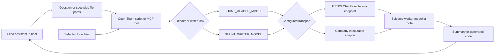
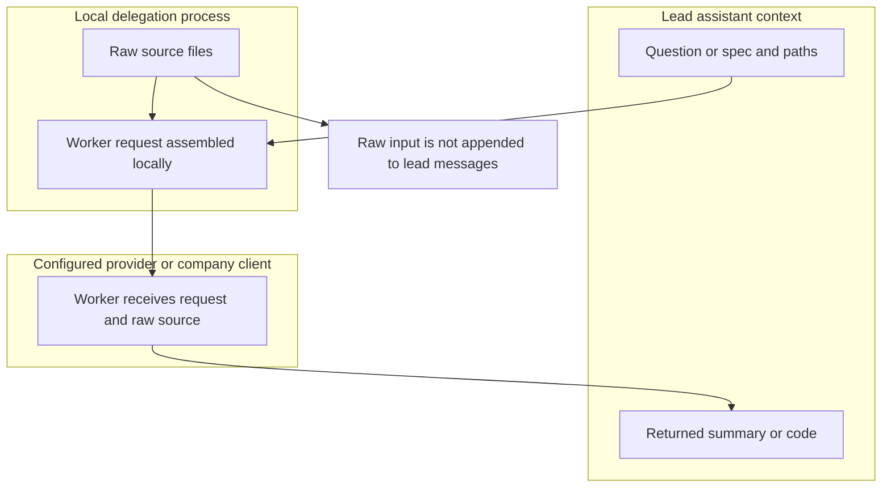
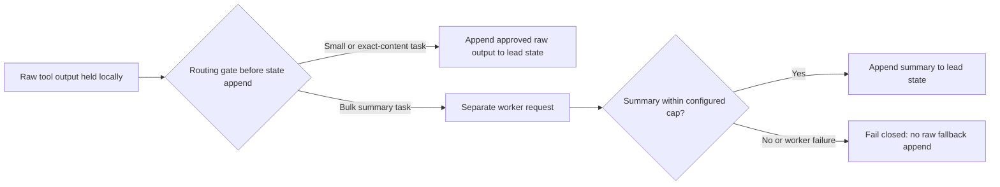

# Open Shunt

Route bulk file reading and predictable code generation to models you choose.
Use your own API credentials or plug in your company's routing client through a
small executable adapter. No external workflow platform or model registry is required.

Use the stdio MCP server from **Claude Code, Codex, or Cursor** (see
[host setup](hosts/README.md)). The native Claude Code plugin additionally retains
large-read hooks and two skills; those hooks are not installed in other hosts.
The scripts also work independently from a terminal. Each invocation is one shot: Shunt does not
maintain conversation history. Provider retention and billing policies still apply.

## Architecture: choose the worker, isolate the bulk input

Open Shunt separates **model selection** from **context isolation**. Model
selection chooses the configured reader/writer route and transport. Context
isolation comes from sending file contents directly from a local script or MCP
server to that worker, rather than asking the lead assistant to read and relay
those contents. Changing a model ID alone does not create this isolation.



The task instructions and raw files go to the worker; its answer goes back to the
lead. The lead retains responsibility for reasoning, reviewing output, and making
precise edits. A reader is instructed to answer concisely, but this is not a
lossless compressor or an enforced output-size guarantee. A worker can quote raw
source in its answer. The writer returns code, not necessarily a summary.

### Where the raw state lives



This pattern avoids a routine raw-file round trip through the lead's context. It does
not erase files the lead has already read, prevent a host from reading them later,
or hide worker output from the host. It is not a security sandbox: selected source
leaves the local machine for the configured endpoint unless your adapter keeps it
local. Apply your company's data-handling, logging, and retention policies.

### Who decides to delegate?

- **Claude Code native plugin:** hooks intercept supported large full-file reads
  and redirect the lead to the bulk-reader skill. They do not intercept every
  possible read and do not automatically route all tool calls. Code writing is
  skill-driven.
- **Codex, Cursor, or Claude Code over MCP:** the host explicitly calls
  `bulk_read` or `code_write`. MCP exposes tools; it does not install a universal
  read-interception layer. Project instructions can encourage delegation.
- **Your own harness:** call the scripts or use the same worker transport from
  an orchestration layer you control. The [harness examples](examples/harness/)
  illustrate where routing decisions and separate worker inputs belong; they are
  not production middleware or a drop-in host-wide interception system.

The runnable harness examples make the state-write decision explicit:



This last diagram describes the **example harness policy**, not an implicit filter
inside every Open Shunt host integration. A real harness must run the gate before
its own state append; calling a summarizer after appending the raw output is too
late to isolate that context. The example's summary cap is an application policy,
not a guarantee that all shell/MCP worker outputs are bounded.

MCP `code_write` returns code for review without writing files. The shell
`code-write` script additionally supports explicit `--target` writes. Both use
the configured writer model, and neither executes the generated code.

## Requirements and local installation

- Bash, Python 3, and standard Unix utilities; `jq` for hooks and hook tests.
- An approved model endpoint and credentials, or your company's executable adapter.
- Claude Code only if using the plugin hooks/skills.

From the extracted plugin directory, configure one transport below, then launch:

```bash
claude --plugin-dir "$PWD"
```

Set variables in the launching environment (or your host's environment configuration).
Keep credentials in your secret manager/environment, never in committed configuration.

## Option A: your API credentials

The built-in transport uses the OpenAI-compatible **Chat Completions** JSON protocol,
not a provider-specific SDK. It sends `model` and `messages` and reads
`choices[0].message.content`. Use a custom adapter for other schemas or authentication.

```bash
export SHUNT_PROVIDER=openai-compatible
export SHUNT_API_URL='https://your-approved-endpoint.example/v1/chat/completions'
export SHUNT_API_KEY_ENV=COMPANY_MODEL_API_KEY
# Inject COMPANY_MODEL_API_KEY from your secret manager; do not commit it.
export SHUNT_READER_MODEL='your-reader-model-id'
export SHUNT_WRITER_MODEL='your-writer-model-id'
```

The URL is the full endpoint, not a base URL. HTTPS is required. Authentication is
`Authorization: Bearer <value of configured key variable>`. No provider/model is
silently selected. Compatibility depends on the endpoint's supported schema.

## Option B: your company's client

```bash
export SHUNT_PROVIDER=custom
export SHUNT_ADAPTER='/absolute/path/to/company-shunt-adapter'
export SHUNT_READER_MODEL='company-reader-route'
export SHUNT_WRITER_MODEL='company-writer-route'
```

The adapter is an executable file, **not a shell command string**. Use a wrapper
script when your SDK needs an interpreter, virtual environment, or extra arguments.
See `examples/company-adapter.py`: it deliberately fails until you implement your
company's client call. No internal Intuit API or SDK is assumed.

### Adapter contract (version 1)

Read one UTF-8 JSON object from stdin:

```json
{"version":1,"task":"bulk-reader","model":"company-reader-route","messages":[{"role":"system","content":"task instructions"},{"role":"user","content":"files and question"}],"timeout_seconds":180}
```

`task` is `bulk-reader` or `code-writer`. Forward the model and both messages;
Shunt supplies task-specific instructions. Write exactly one JSON object to stdout:

```json
{"text":"Nonempty model answer"}
```

Exit nonzero on failure. Do not put banners/logs on stdout. Diagnostics and SDK
logs must not disclose secrets or source text. Shunt suppresses adapter stderr on
failure to reduce accidental secret leakage. Credentials stay in the inherited
environment, not the JSON request. Shunt enforces a subprocess timeout; adapters
should also set their SDK's request deadline and terminate any child processes.

## Use

```bash
./scripts/bulk-read --question 'Which methods access the database?' \
  --paths src/service.ts src/repository.ts

# Inspect output before asking to write a target.
./scripts/code-write --spec 'Write tests matching these conventions' \
  --reference tests/example.test.ts

./scripts/code-write --spec 'Write tests matching these conventions' \
  --reference tests/example.test.ts --target tests/new.test.ts
```

`code-write --target` overwrites that file after a successful response. Review
generated code before running or committing it. Reference files are required.
Markdown fence lines are stripped. Worker output is untrusted, not automatically
executed. Source files are sent to the configured provider: use only approved
endpoints and avoid secrets or sensitive files your provider cannot receive.

## Configuration

| Variable | Default | Meaning |
|---|---|---|
| `SHUNT_PROVIDER` | `openai-compatible` | Built-in HTTP or `custom` adapter |
| `SHUNT_READER_MODEL` | required | Model/route for bulk reads |
| `SHUNT_WRITER_MODEL` | required | Model/route for code generation |
| `SHUNT_API_URL` | required for HTTP | Full HTTPS Chat Completions endpoint |
| `SHUNT_API_KEY_ENV` | `SHUNT_API_KEY` | Name of credential environment variable |
| `SHUNT_ADAPTER` | required for custom | Absolute executable path |
| `SHUNT_TIMEOUT_SECONDS` | `180` | Adapter deadline / HTTP socket timeout |
| `SHUNT_MAX_PAYLOAD_BYTES` | `1000000` | Serialized request byte ceiling |
| `SHUNT_MIN_LINES` | `350` | Hook large-file threshold |

Payload travels through stdin/HTTP, not a command-line argument. The byte ceiling
is not a model token limit; split files to fit the selected model's context window.
The built-in HTTP timeout is a socket timeout, not a guaranteed wall-clock deadline.

## Hooks and boundaries

Large full-file reads are redirected to the bulk-reader skill. Targeted reads with
offset/limit remain available for exact edits. The Bash hook catches common large
`cat`/`head`/`tail` reads, not every possible shell command. It is a context-saving
hint, not a security boundary. Small reads, debugging, architecture, and precision
editing belong with the primary assistant. Code generation remains skill-driven.

## Offline verification

```bash
bash evals/run.sh
python3 evals/mcp_test.py
```

Default tests use fixture files and mocked transports, with no credentials or paid
calls. `--benchmark` / `--all` additionally invoke your configured live provider and
may incur charges; do not use them for offline verification. Historical benchmark
fixtures are scenarios, not a performance guarantee for your models.

See `UPSTREAM.md` for provenance and `LICENSE` for the unchanged Apache-2.0 license.

## Why a separate model caller?

You do not need this transport merely to delegate to another supported Claude model.
Claude Code's [native subagents](https://code.claude.com/docs/en/sub-agents) can use a
separate context and a model setting such as `haiku`; that is the simpler alternative
when native Claude routing fits your needs. This adapter exists for your own company
routing client, gateway credentials, or cross-provider worker models.

Native subagent integration is not implemented or verified here. In particular, these
large-read hooks must not prevent a reader subagent from reading its own inputs. Do
not assume that adding an agent file alone safely integrates native delegation.

For the host configuration launch smoke tests (Python 3.11+):
`python3 evals/host_config_test.py`. These substitute local paths and initialize
all three templates; they do not launch the host applications.
